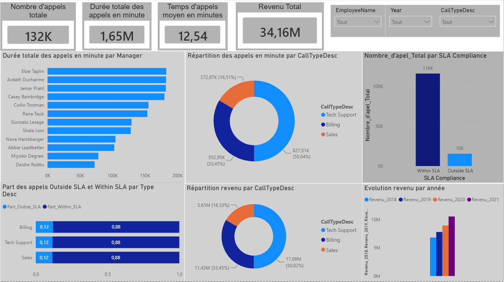

# Call Center — Analyse des performances avec Power BI

## Présentation du projet

Ce projet de Data Analysis consiste à analyser les performances opérationnelles et commerciales d'un centre d'appels à travers un tableau de bord interactif développé avec Microsoft Power BI.

L'objectif est d'améliorer le suivi de l'activité, d'identifier les principaux indicateurs de performance et de faciliter la prise de décision.

## Objectifs de l'analyse

- Suivre le volume total des appels.
- Étudier la durée moyenne et cumulée des appels.
- Analyser les performances par employé et par manager.
- Évaluer le respect des engagements de service (SLA).
- Comparer les revenus générés par type d'appel.
- Étudier l'évolution annuelle des revenus.

## Outil utilisé

- Microsoft Power BI Desktop
- Visualisation interactive des données
- Création de KPI et de graphiques
- Filtres par employé, année et type d'appel

## Tableau de bord

## Principaux résultats

| Indicateur | Valeur affichée |
|---|---|
| Nombre total d'appels | 132 K |
| Durée totale des appels | 1,65 million de minutes |
| Durée moyenne des appels | 12,54 minutes |
| Revenu total | 34,16 millions |
| Appels conformes au SLA | Environ 116 K |
| Appels hors SLA | Environ 16 K |

## Analyses réalisées

**1. Analyse de l'activité**

Visualisation du volume d'appels et de leur durée selon les managers et les catégories d'activité.

**2. Analyse du SLA**

Comparaison des appels respectant les engagements de service et des appels hors SLA, avec environ 88 % d'appels conformes.

**3. Analyse des revenus**

Répartition des revenus entre les catégories Tech Support, Billing et Sales.

**4. Analyse temporelle**

Comparaison de l'évolution des revenus entre 2018 et 2021.

## Compétences mises en pratique

- Business Intelligence
- Analyse descriptive des données
- Conception de tableaux de bord Power BI
- Création et suivi d'indicateurs KPI
- Analyse de la performance opérationnelle
- Data Visualization

## Fichiers du projet

- `Projet Call center.pbix` : fichier du rapport Power BI.
- `Dashboard-Call-Center.png` : aperçu du tableau de bord.

## Auteur

**Moustapha Gano**

Portfolio Data Analyst — Power BI | Analyse de données | Business Intelligence
